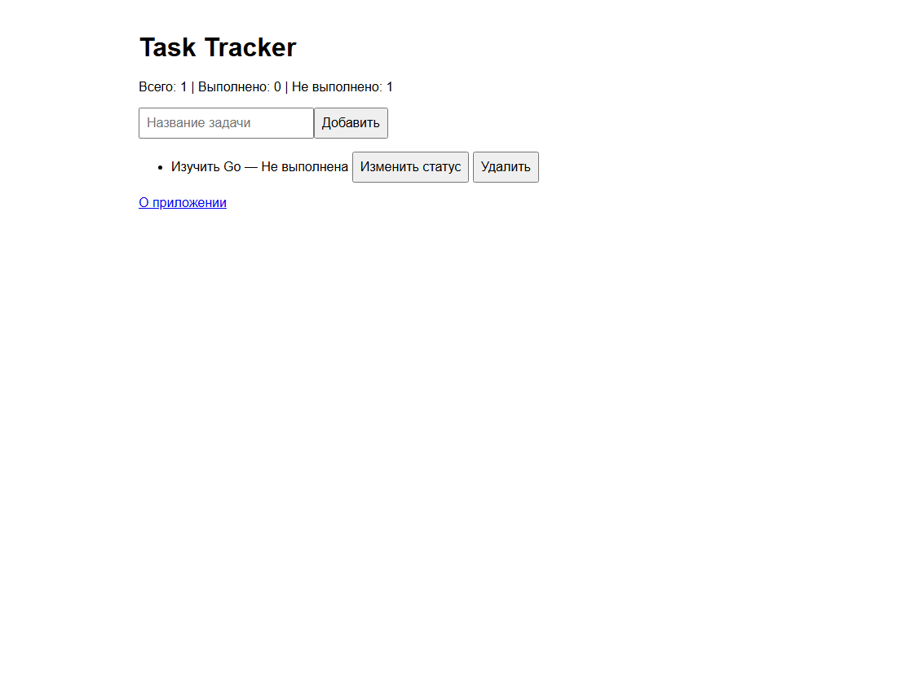

# Лабораторная работа 11 — сайт со списком задач

## Краткий отчёт

Сайт для добавления, изменения статуса и удаления задач.

## Выполнение по заданию

### 1. Данные и шаблон

Структура `Task` и срез хранят задачи. `PageData` передаёт список и статистику в HTML-шаблон.

### 2. Маршруты

`GET /` показывает задачи, `POST /tasks` добавляет, `POST /tasks/complete` меняет статус, `POST /tasks/delete` удаляет, `GET /about` показывает описание.

### 3. Проверка

Проверены добавление, пустое название, переключение статуса, удаление, неизвестный ID и статистика.

## Запуск

В PowerShell из этой папки:

```powershell
go run .
```

Откройте `http://localhost:8080`. Остановка сервера — Ctrl+C. После перезапуска данные очищаются.

## Скриншот выполнения



## Вывод

Задачи хранятся в памяти. Формы отправляют POST-запросы, а после изменения сервер возвращает пользователя на главную страницу.
